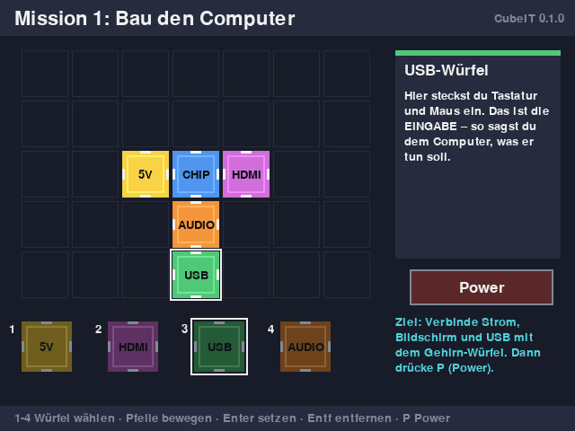

# CubeIT – Swiss Magnetic Cube Computer

**A computer that children can take apart with their hands.**
Each function (processor, power, display, USB, sound) is a magnetic cube. Snap the cubes together, the
computer boots, and children learn how a computer is built and how it works.

Started in 2015 around the USD 9 **C.H.I.P.** board. Paused because of the regulatory and bureaucratic
requirements of the Swiss education system. Published here as **free, open documentation, tools and a
learning game**.



## What's in this repository

| Path | Content |
|---|---|
| [`game/`](game/) | **Free micro learning game** "Bau deinen Computer" (build your computer): 3 missions, DE/FR/IT/EN, Python + pygame, runs on C.H.I.P. (2015) and any PC (today) |
| [`docs/00-project-history.md`](docs/00-project-history.md) | Story, timeline, why we stopped, lessons learned |
| [`docs/01-concept.md`](docs/01-concept.md) | Teaching concept, cube catalogue, lesson sequence |
| [`docs/02-hardware.md`](docs/02-hardware.md) | Architecture, C.H.I.P. data, CubeBus magnetic connector pinout, power budget, child safety |
| [`docs/03-software-and-tools.md`](docs/03-software-and-tools.md) | 2015 software stack and lab workflow |
| [`docs/04-lehrplan21-mapping.md`](docs/04-lehrplan21-mapping.md) | Mapping to Lehrplan 21 (MI.2.1–2.3), PER, Piano di studio TI |
| [`docs/05-regulatory-roadmap.md`](docs/05-regulatory-roadmap.md) | **Swiss regulatory & bureaucratic roadmap**: cantonal federalism, teaching-material approval, toy/EMC/radio conformity, procurement, feasibility gate, restart path |
| [`tools/`](tools/) | `cubetool.py` (cube ID EEPROMs, CubeBus scan, `--simulate`), `xio-test.sh` (GPIO), `chip-setup.sh` (classroom provisioning) |
| [`hardware/`](hardware/) | Prototype bill of materials (2015 prices) |
| [`tests/`](tests/) | Headless tests for the game and tools |

## Quick start

```bash
python3 -m pip install pygame
```

```bash
python3 game/cubeit_game.py
```

## Key findings, in one paragraph

The technology was feasible in 2015. Market access was not. Compulsory schooling is **cantonal**
(Art. 62 BV), so there is no federal customer. Before the first school sale, the project would have
needed product conformity (toy or IT equipment, EMC, radio, LiPo, take-back), a **PH-evaluated pilot**,
cantonal teaching-material approval and procurement suitability. We estimate CHF 30–80k and 2–4 years.
The realistic path today is **open source → one teacher → one PH → one canton**. Details:
[docs/05](docs/05-regulatory-roadmap.md).

## License

- Code (`game/`, `tools/`, `tests/`): **MIT**, see [LICENSE](LICENSE)
- Documentation and images (`docs/`, `hardware/`): **CC BY-SA 4.0**

Free for schools. Copying, translating and improving it are explicitly welcome.
