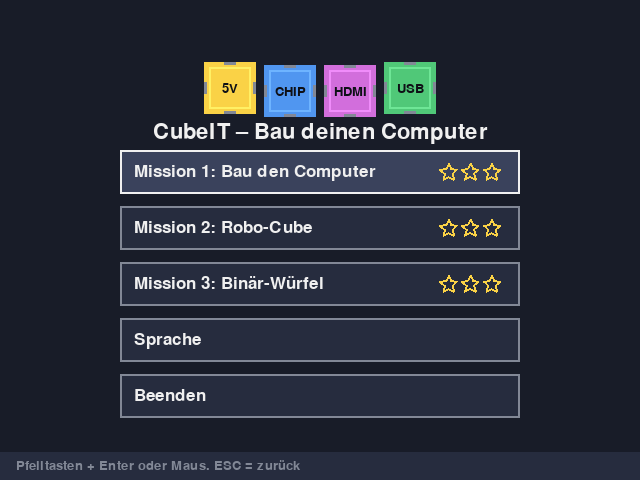
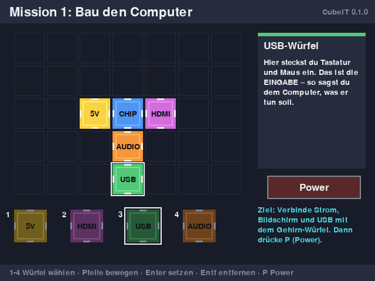
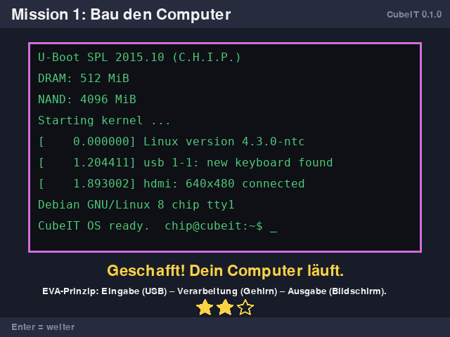
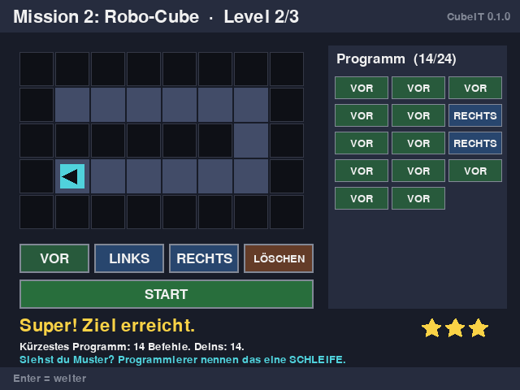
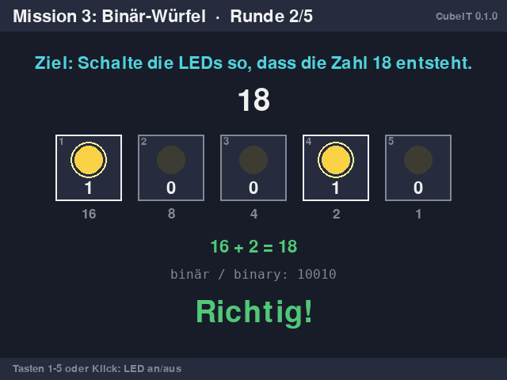

# CubeIT Micro Learning Game – "Bau deinen Computer" (build your computer)

Free micro learning game for ages 8–12. Three missions of about 5 minutes each. Languages: Deutsch (CH),
Français, Italiano, English.
It is written the way we could have written it in 2015 for the **C.H.I.P.** (Python 2.7 + pygame
1.9.2), and it also runs unchanged on Python 3 + pygame 2.

| Mission | Topic (Lehrplan 21) | What children learn |
|---|---|---|
| 1 · Bau den Computer (build the computer) | MI.2.3 Informatiksysteme | Brain + power + display + USB: the IPO/EVA model. Magnets must touch |
| 2 · Robo-Cube | MI.2.2 Algorithmen | Instruction sequences, bugs, debugging, shortest program, loop pattern |
| 3 · Binär-Würfel (binary cubes) | MI.2.1 Datenstrukturen | Numbers 1–31 from 5 LEDs (16-8-4-2-1) |







## Start

C.H.I.P. / Debian / Raspberry Pi OS:

```bash
sudo apt-get install python-pygame      # 2015 (Python 2)
```

```bash
python3 -m pip install pygame           # today (Python 3)
```

```bash
python game/cubeit_game.py              # window 640x480
```

```bash
python game/cubeit_game.py --fullscreen --lang=fr
```

Options: `--fullscreen`, `--size=480x272` (Pocket C.H.I.P.), `--lang=de|fr|it|en`.

## Controls

Keyboard only (Pocket C.H.I.P. friendly) or mouse.

| Mission | Keys |
|---|---|
| Menu | ↑ ↓ Enter, ESC = quit |
| 1 | `1`–`4` choose cube · arrow keys move · Enter place · Del remove · `P` power on |
| 2 | ↑ forward · ← → turn · Backspace delete · Space run |
| 3 | `1`–`5` switch LED on/off |

## For teachers

- **No data, no network.** Only stars and the language are stored, in `~/.cubeit_progress.json`.
- Stars show progress, not grades: Mission 1 counts failed attempts, Mission 2 compares with the
  shortest program, Mission 3 counts extra clicks.
- Discussion after Mission 1: *"Why did the computer not start without the USB cube? Would it start
  without the audio cube?"*
- Discussion after Mission 2: *"Level 2 had VOR VOR VOR VOR VOR (forward ×5) twice. How could you write
  that more briefly?"* → introduction to loops.

## Test (headless)

```bash
SDL_VIDEODRIVER=dummy SDL_AUDIODRIVER=dummy python tests/test_game.py
```

License: MIT – free for schools, copying and adapting are explicitly welcome.
